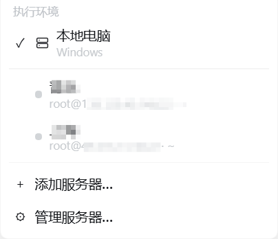
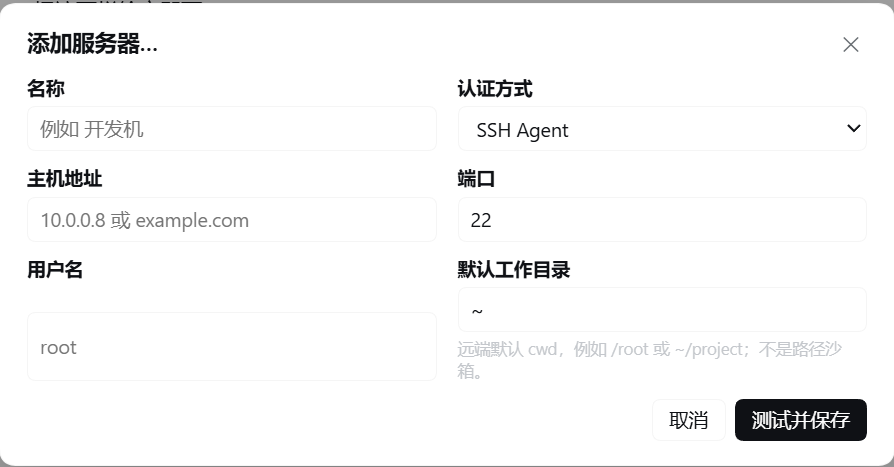

# DSH Remote SSH

[English](./README.md) | [简体中文](./README.zh-CN.md)

Let **DeepSeek Harness (DSH)** operate remote Linux servers through its own native tools.

After choosing a saved server next to the composer, DSH's existing `read / write / edit / apply_patch / glob / grep / bash / terminal` tools execute on that host. The plugin does not patch DSH, and the server needs no DSH, plugin, Node.js, or Python installation.

## Features

- Add, test, manage, and select SSH servers inside the DSH page.
- Switch the execution environment between the local computer and a saved server.
- Keep the official DSH tools; no capability-limited `ssh_*` replacements.
- Files over SFTP, commands over SSH exec / shell, an interactive terminal over an SSH PTY.
- Keep the official `glob / grep`, provisioning and caching remote Linux ripgrep automatically.
- SSH Agent, private-key file, and ephemeral password authentication.
- Verify the SSH host-key fingerprint on first use and refuse a changed fingerprint.
- The DSH Host pools and reuses one connection per server.
- Each conversation can choose its own server, with separate providers per Agent.
- Execution targets stay locked while a conversation turn is running.

## Install

Requires DSH `0.2.2-rc.1` (Web/Desktop). Clone the repository, then install
the directory as a local bundle into the active profile:

```bat
git clone https://github.com/Ruiwang66/dsh-remote-ssh.git
dsh plugin --profile desktop add ./dsh-remote-ssh
dsh web
```

The repository includes the portable `dist/` bundle and Linux ripgrep assets;
installation does not require building the plugin or running `npm install`.

## Development

Use Node.js 24 or newer and run `npm ci`. Building and testing also require
the matching DSH reference packages in `../ref/dsh-0.2.2`; see
[HANDOFF.md](./HANDOFF.md) for extraction instructions and the architecture,
and [TESTING.md](./TESTING.md) for validation commands.

## Use

1. Start DSH Web.
2. Open the execution-environment picker at the left of the composer.
3. Choose “Add server”.
4. Fill in the connection, authentication, and default working directory.
5. Verify the fingerprint the page shows, then choose “Trust and save”.
6. Select that server in the composer.

The model keeps using the official DSH tools; only the execution location behind them changes.

## Screenshots and walkthrough

The screenshots below show the Chinese interface. The plugin also provides English UI text.

### 1. Open the execution-environment picker

The picker appears at the left of the conversation input. “本地电脑” means
“Local computer”: the native tools currently execute on your own computer.
Click it to choose a different execution environment.


### 2. Choose or manage a server

The menu lists the local computer and saved SSH servers. Select a server to
run the conversation's file, search, shell, and terminal tools on that host.
Use “添加服务器…” (Add server) to create a connection, or “管理服务器…”
(Manage servers) to reconnect, edit, or remove saved connections. Wait until
the current turn finishes before switching environments.



### 3. Add and test a connection

Enter a display name, host, port (22 by default), username, authentication
method, and default working directory. Choose SSH Agent, a private-key file,
or an ephemeral password. `~` uses the remote account's home directory; the
directory sets the default `cwd` and does not restrict access to other paths.

Click “测试并保存” (Test and save). On first connection, verify the displayed
SHA256 host-key fingerprint before trusting it. The plugin saves the server
only after the SSH handshake, SFTP, and command execution checks succeed,
then selects it for the conversation. Passwords stay in Host memory and
must be entered again after a Host restart.



## Architecture

```text
Model
  │
official DSH tools: read · write · edit · apply_patch · glob · grep · bash · terminal
  │
official seams: ctx.fs · ctx.subprocess · ctx.shell · ctx.terminals
  │
one isolated execution world per Agent (Cordis isolation scopes)
  ├─ local: native DSH providers
  └─ remote: SFTP filesystem · SSH exec processes · SSH PTY terminal · remote ripgrep
```

## Authentication

| Mode | Behavior |
| --- | --- |
| SSH Agent | Asks the agent to sign; never reads key material and never enables agent forwarding |
| Private-key file | Stores only the path and reads the file when connecting |
| Ephemeral password | Kept in the current DSH Host process memory only; a restart forgets it |

## Remote requirements and security boundary

- The target must provide SSH / SFTP and a POSIX shell on Linux/Unix.
- Each server has a default working directory. It is a default `cwd`, not a path sandbox.
- Effective access equals the remote SSH account's permissions; the remote provider never exposes the DSH Host filesystem to the server.
- Model API keys and base URLs stay owned by DSH; this plugin neither reads nor stores them.
- Remote search provisions ripgrep for Linux x64, arm64, or arm; remote `fs.watch` is unsupported.
- DSH upgrades require compatibility checks against the new Host APIs; see [TESTING.md](./TESTING.md).

## State

Saved servers and the per-session execution target live in `$DSH_HOME/remote-ssh/state.json` (default `~/.dsh/remote-ssh/state.json`, mode 0600). Passwords are never written there.

## License

MIT
